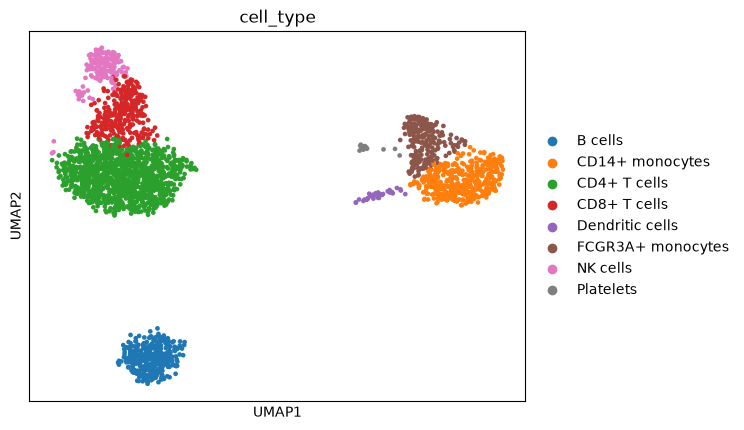

# scrna-copilot

A reproducible single-cell RNA-seq (scRNA-seq) pipeline built on scanpy, exposed as an **MCP server** so an LLM agent such as Claude can run the analysis step by step: load data, run QC, inspect the result, tune parameters, cluster, and label cell types from marker genes.

It is a learning and portfolio project, run on one public dataset (10x Genomics PBMC 3k). The [limitations](#limitations) section says what it does not show.

## Results on PBMC 3k



Default settings, `random_state=0`:

| Stage | Result |
|---|---|
| Cells loaded | 2700 |
| After QC | 2638 cells, 13,714 genes (median 820 genes per cell, median 2.0% mitochondrial reads) |
| Clusters (Leiden, resolution 1.0) | 9 |

| Cluster | Cells | Label | Score |
|---|---|---|---|
| 0 | 508 | CD4+ T cells | 58.5 |
| 1 | 341 | B cells | 84.3 |
| 2 | 647 | CD4+ T cells | 65.9 |
| 3 | 223 | FCGR3A+ monocytes | 75.4 |
| 4 | 155 | NK cells | 70.2 |
| 5 | 299 | CD8+ T cells | 71.2 |
| 6 | 413 | CD14+ monocytes | 85.1 |
| 7 | 37 | Dendritic cells | 67.6 |
| 8 | 15 | Platelets | 96.7 |

The same table is in `results/annotations.csv`, and the top marker genes per cluster are in `results/markers.csv`.

### How labels are assigned

`annotate()` scores each cluster against a signature per cell type: the mean percentage of cells expressing the signature's positive genes minus the mean percentage expressing its negative genes (for example NK cells are `GNLY`, `NKG7`, `GZMB` and *not* `CD3D`, `CD3E`). The best-scoring signature wins, and a cluster scoring below 25 is labelled "Unassigned". Labels are therefore tied to marker evidence and not to cluster numbers, which change between settings. The signatures are in `PBMC_SIGNATURES` in `pipeline.py`.

## Reproducibility

- Every step writes its parameters to `adata.uns["provenance"]`. `save_h5ad` stores this as JSON in the `.h5ad` file and `load_h5ad` restores it, and the `provenance` MCP tool returns it.
- With a fixed seed, two runs in separate processes gave identical cluster labels and cell types.
- **Across seeds, the result is stable but not identical.** Full pipeline, seeds 0–4 (`scripts/seed_stability.py`, output in `results/seed_stability.csv`):

| Seed | Clusters | Cell-type agreement with seed 0 (ARI) | Cluster agreement with seed 0 (ARI) | NK cells found |
|---|---|---|---|---|
| 0 | 9 | 1.000 | 1.000 | 155 |
| 1 | 9 | 0.991 | 0.912 | 155 |
| 2 | 9 | 0.973 | 0.827 | 139 |
| 3 | 9 | 0.980 | 0.820 | 141 |
| 4 | 9 | 0.989 | 0.908 | 155 |

B cells (341) and platelets (15) were identical in every seed. Dendritic cells were 37–41, and the other types varied by a few to about 10 cells.

### Why resolution 1.0 and converged Leiden

The first defaults (resolution 0.8, Leiden stopped after 2 iterations) separated NK cells from CD8+ T cells in only 3 of 5 seeds. NK cells sit near a cluster boundary. Tests that varied one source of randomness at a time showed that the neighbor-graph seed had no effect and the Leiden seed was the whole cause. On a fixed graph with 10 Leiden seeds, NK cells were found in 5/10 at resolution 0.8, 9/10 at 1.0 with the old iteration setting, and 10/10 at 1.0 with Leiden run to convergence (`n_iterations=-1`), which also gave exactly 9 clusters each time. **These settings were chosen after looking at this dataset's stability, so they are tuned to PBMC 3k and not a general recommendation.**

## Tools exposed over MCP

| Tool | What it does |
|---|---|
| `load_dataset` | PBMC 3k (downloaded by scanpy on first use) or a path to an `.h5ad` file |
| `quality_control` | Filters cells by minimum genes, a maximum-genes ceiling (a crude doublet proxy) and mitochondrial %; drops rare genes |
| `normalize_and_pca` | Library-size normalization, log1p, 2000 highly variable genes, scaling, PCA |
| `cluster_cells` | kNN graph, Leiden clustering, UMAP |
| `marker_genes` | Wilcoxon rank-sum markers per cluster |
| `annotate_cell_types` | Marker-signature labels per cluster |
| `provenance` | Every step and parameter so far |

The tools are stateful: the dataset stays in the server's memory between calls, and calls made out of order return an error telling the agent which earlier step to run first. Running the whole chain through the server on PBMC 3k gave the same cell counts, cluster sizes and labels as the standalone script.

## Setup

Python 3.10 or newer (developed on 3.11; the newest Python releases may not yet be supported by scanpy's numba dependency).

```bash
python3.11 -m venv .venv && source .venv/bin/activate
pip install -e ".[dev]"
pytest -q
```

Run the full pipeline:

```bash
python -m scrna_copilot.pipeline
python scripts/seed_stability.py --seeds 0 1 2 3 4   # optional
```

This writes `results/markers.csv`, `results/annotations.csv`, `results/processed.h5ad`, `results/umap_leiden.png` and `results/umap_cell_type.png`. The dataset cache is `data/` in the repository (override with `SCRNA_COPILOT_DATA_DIR`).

## Use it from Claude Desktop

Add this to `claude_desktop_config.json`, then fully restart Claude Desktop:

```json
{
  "mcpServers": {
    "scrna-copilot": {
      "command": "/full/path/to/.venv/bin/python",
      "args": ["-m", "scrna_copilot.mcp_server"]
    }
  }
}
```

Then ask something like: *"Load pbmc3k, run QC and tell me how many cells were removed, normalize, cluster, annotate cell types, and show the provenance."*

If the server fails to start with `No module named 'scrna_copilot'`: on one macOS machine the editable-install `.pth` file carried the `hidden` flag, which makes Python skip it. Use `"command": ".../.venv/bin/python"` with `"args": ["-c", "import sys; sys.path.insert(0, '/full/path/to/src'); from scrna_copilot.mcp_server import main; main()"]`, or run `chflags nohidden` on the `.pth` files in the venv's `site-packages`.

## Tests

10 tests, none of which need a download:

- the pipeline on synthetic count data with known groups (QC, full run, recovery of groups, reproducibility, stability across seeds);
- a save and reload round trip that checks provenance survives the `.h5ad` file;
- annotation against ground truth, and the "Unassigned" fallback;
- the MCP layer: expected tool list, out-of-order calls rejected, and a full tool chain on synthetic data.

`mcp` is pinned to `<2` because mcp 2.x renamed `FastMCP` and changed other APIs; migrating is future work.

## Limitations

- **One dataset.** Everything above is PBMC 3k. The signatures are PBMC-specific and the settings are tuned to it. The pipeline has not been tested on other tissues or datasets.
- **Labels are not validated.** They are marker-based calls, compared only against my own manual reading of the marker genes and not against an independent reference annotation.
- **T cell subtypes are not resolved.** Clusters 0 and 2 both get "CD4+ T cells", and the two clusters did not separate into naive and memory T cells in a convincing way. `CD4` itself is detected in few cells (a known limit of 3' droplet data), so the label rests on `CD3D`/`CD3E`/`IL7R` plus the absence of cytotoxic genes.
- **Small groups.** Platelets (15 cells) and dendritic cells (37) are too small for confident statistics. The dendritic cluster has the highest median genes per cell of any cluster and might include some doublets. No dedicated doublet detector (such as Scrublet) was run.
- **Seeds and environment.** Only 5 full-pipeline seeds were tested, on one machine, with one set of library versions.
- **Server state.** The MCP server keeps one dataset in process memory with no per-user isolation, so it is a demo design and not a multi-user service.

## Tech

Python, scanpy, AnnData, Leiden (igraph), UMAP, Model Context Protocol (FastMCP, `mcp<2`), pytest.
